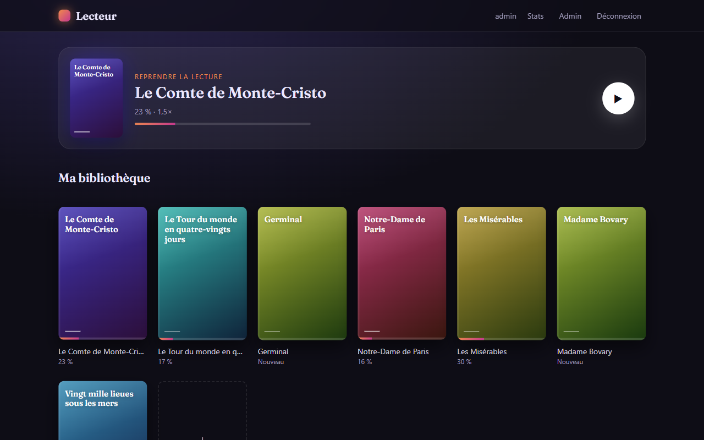
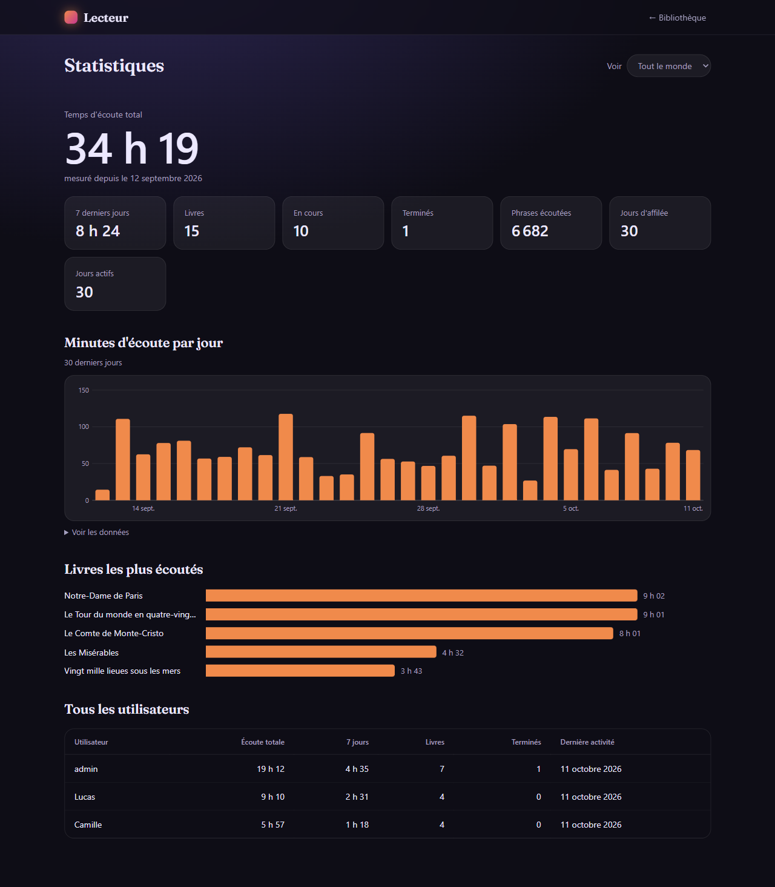
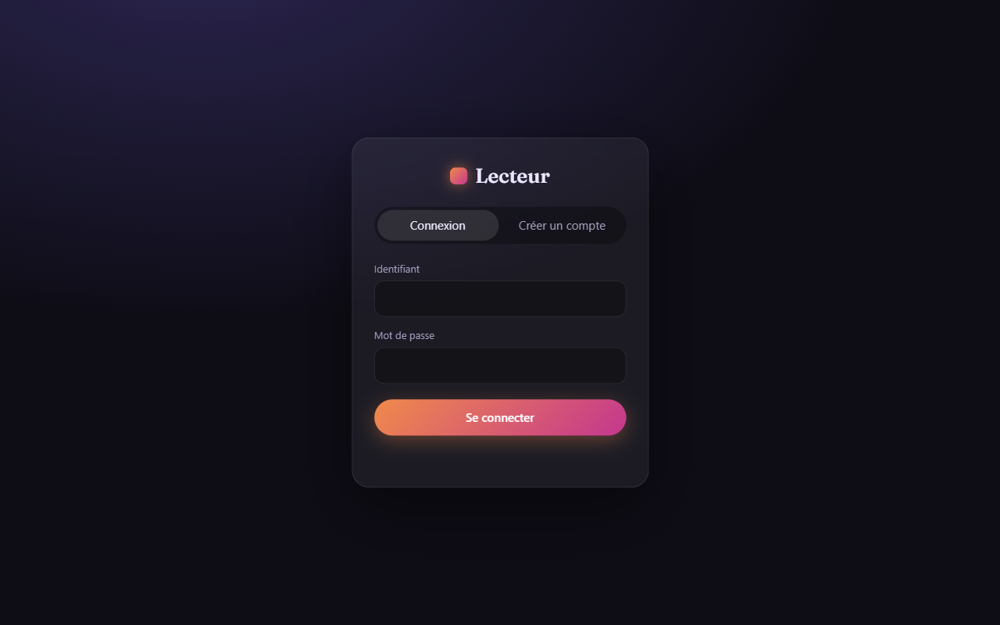
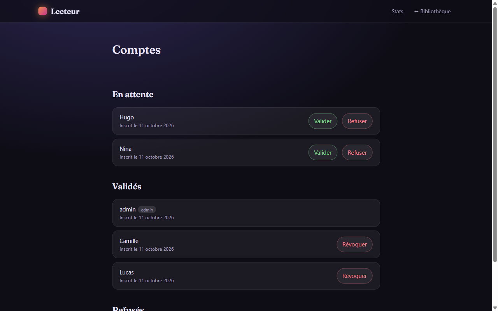
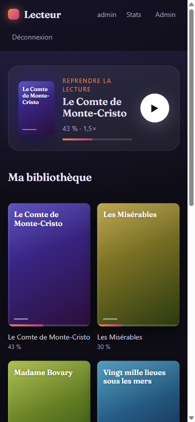

# Lecteur

Un lecteur de PDF à voix haute, auto-hébergé. On importe ses livres en PDF, on clique sur une phrase, et la voix de Google Traduction (accent de France) lit la suite pendant que chaque phrase est surlignée. La lecture reprend là où on s'était arrêté, sur n'importe quel appareil.

En option, chacun peut transformer un livre en **livre audio** à voix IA, avec la voix de son choix, générée par [VoiceStudio](https://github.com/debpalash/VoiceStudio) sur un serveur à carte graphique réveillé à la demande. La voix Google sert le temps que l'IA travaille, puis le lecteur passe tout seul sur la voix IA, phrase par phrase.

L'accès est fermé : chacun peut demander un compte, mais seul l'administrateur peut le valider.



## Fonctionnalités

- **Bibliothèque personnelle** : chaque compte a ses propres livres, avec une couverture générée à partir du titre (ou une image importée : JPEG, PNG ou WebP, 5 Mo maximum) et une barre de progression. Une carte « Reprendre la lecture » mène directement au dernier livre ouvert. Import par glisser-déposer, jusqu'à 50 Mo par PDF.
- **Livres audio IA** (optionnel) : la personne écoute la démo de chaque voix du catalogue, en choisit une et lance la transformation (elle peut changer de voix, ce qui refait tout le livre, ou supprimer le livre audio). Le livre part dans une file de génération : le serveur VoiceStudio est réveillé par Wake-on-LAN, chaque phrase est générée puis rangée ici. La file suit l'auditeur (elle génère d'abord ce qui est juste devant sa position, puis complète tout le livre, même quand personne n'écoute), et une phrase demandée avant d'être prête est générée à la demande (1 à 2 s) puis mise en stock. La voix Google ne sert plus que pendant la minute de réveil du serveur IA, ou s'il est en panne. Le livre audio reste donc écoutable quand le serveur IA est éteint. Si c'est la file qui l'a réveillé, il est éteint 10 minutes après la fin du travail.
- **Durée de vie** : un livre (PDF, couverture, livre audio) est supprimé 1 mois après sa dernière écoute, sauf pendant sa génération. Sa position reste gardée jusqu'à 2 mois après cette dernière écoute : en réimportant le même PDF, la lecture reprend là où elle s'était arrêtée.
- **Lecture à voix haute** : la phrase en cours est surlignée et suivie à l'écran. On clique sur n'importe quelle phrase pour lire à partir de là. Vitesse de 0,8× à 5×, sans changer la hauteur de la voix. Les deux phrases suivantes sont préparées à l'avance pour éviter les blancs.
- **Progression enregistrée** : la phrase atteinte et la vitesse choisie sont sauvegardées pour chaque livre.
- **Comptes validés par l'admin** : inscription libre, mais connexion impossible tant que l'admin n'a pas validé le compte. Une révocation déconnecte la personne immédiatement.
- **Panel admin** : valider, révoquer ou supprimer un compte (avec ses livres et fichiers) ; voir et écouter les livres de chacun en lecture seule (sa progression et ses stats ne bougent pas) ; supprimer un livre ; piloter les livres audio (pause, reprendre, relancer, supprimer) ; gérer le catalogue de voix (essai, ajout avec sa démo, retrait) ; réveiller ou éteindre le serveur IA ; voir la place prise sur le disque.
- **Statistiques** : temps d'écoute réel (pauses exclues), minutes par jour sur 30 jours, livres en cours et terminés, jours d'affilée, livres les plus écoutés. Chacun voit les siennes ; l'admin voit celles de tout le monde.
- **Extraction propre du texte** : les paragraphes sont reconstitués, les mots coupés en fin de ligne recollés, les numéros de page supprimés et les ligatures (fi, ffi) remplacées par les lettres correspondantes.

## Captures

| Lecture | Statistiques |
|---|---|
|  |  |

| Connexion | Validation des comptes |
|---|---|
|  |  |

| Mobile : bibliothèque | Mobile : lecture |
|---|---|
|  |  |

*Captures réalisées avec des comptes fictifs et des classiques du domaine public.*

## Démarrage rapide

Il faut Python 3.10 ou plus récent.

```bash
pip install -r requirements.txt
python serveur.py --admin <identifiant>   # crée le compte admin (le mot de passe est demandé)
python serveur.py                         # http://127.0.0.1:8765
```

Sous Windows, `Lancer.bat` démarre le serveur et ouvre le navigateur.

Les autres comptes se créent depuis la page de connexion, puis se valident sur la page **Admin**.

## Mise en production

Le serveur n'écoute que sur `127.0.0.1:8765`. Pour l'exposer, placez-le derrière un proxy HTTPS et définissez `LECTEUR_HTTPS=1` : les cookies de session reçoivent alors l'attribut `Secure`.

Exemple avec [Tailscale Funnel](https://tailscale.com/kb/1223/funnel), qui fournit une adresse HTTPS publique sans ouvrir de port :

```bash
tailscale funnel --bg 8765
```

Exemple de service systemd (code dans `/opt/lecteur`, exécuté par un utilisateur dédié `lecteur`) :

```ini
[Unit]
Description=Lecteur PDF à voix haute
After=network-online.target
Wants=network-online.target

[Service]
User=lecteur
Group=lecteur
WorkingDirectory=/opt/lecteur
Environment=LECTEUR_HTTPS=1 PYTHONUTF8=1
ExecStart=/opt/lecteur/venv/bin/python serveur.py
Restart=always
NoNewPrivileges=yes
ProtectSystem=strict
ReadWritePaths=/opt/lecteur/donnees
ProtectHome=yes
PrivateTmp=yes

[Install]
WantedBy=multi-user.target
```

Toutes les données sont stockées dans `donnees/` : la base SQLite `lecteur.db`, les PDF importés dans `livres/`, les livres audio dans `audio/` (un MP3 par phrase, environ 250 Mo pour un roman de 11 h), les couvertures dans `couvertures/` et les démos des voix dans `voix/`. Sauvegarder ce dossier suffit. La base est créée et mise à jour automatiquement au démarrage.

### Livres audio IA

Sans `VOICESTUDIO_CLE`, le lecteur fonctionne comme avant, avec la seule voix Google. Pour activer les livres audio, copier `lecteur.env.exemple` en `/opt/lecteur/lecteur.env` (droits `600`), le remplir, ajouter `EnvironmentFile=/opt/lecteur/lecteur.env` au service systemd, et installer `ffmpeg` (sinon les phrases restent en WAV, environ 10 fois plus lourd).

| Variable | Rôle |
|---|---|
| `VOICESTUDIO_URL`, `VOICESTUDIO_CLE` | API VoiceStudio (réseau local uniquement) et sa clé admin |
| `SRV02_MAC` | Adresse MAC du serveur IA, pour le réveiller par Wake-on-LAN (même réseau local) |
| `PVE_URL`, `PVE_NOEUD`, `PVE_JETON`, `PVE_CA` | Extinction automatique par l'API Proxmox, avec un jeton qui n'a que le droit `Sys.PowerMgmt` sur ce nœud. Sans jeton, le serveur IA reste allumé. |

La file s'arrête proprement si le serveur IA s'éteint en cours de route : elle le réveille et reprend au tour suivant. Le serveur IA n'est jamais éteint automatiquement s'il était déjà allumé ou s'il a été réveillé à la main depuis le panel.

## Sécurité

- Mots de passe hachés avec scrypt et un sel par compte.
- Cookie de session `HttpOnly`, `SameSite=Lax`, et `Secure` derrière HTTPS. Les sessions durent 30 jours.
- Blocage de 15 minutes après 5 mauvais mots de passe sur un même identifiant.
- Seul le dossier `public/` est servi : la base et le code source ne sont pas téléchargeables.
- Chaque requête vérifie le propriétaire : un compte ne peut ni lire, ni modifier, ni voir les statistiques des livres d'un autre. Seul l'admin voit tout.
- Couvertures acceptées d'après leurs premiers octets (JPEG, PNG, WebP), jamais de SVG.
- La clé VoiceStudio et le jeton Proxmox restent sur le serveur, dans un fichier lisible par le seul service ; le navigateur ne parle jamais au serveur IA.

## Structure

| Fichier | Rôle |
|---|---|
| `serveur.py` | Serveur HTTP (bibliothèque standard), routes de l'API, synthèse vocale |
| `base.py` | Schéma SQLite, comptes, sessions, livres, progression, statistiques |
| `extraction.py` | Extraction du texte des PDF en paragraphes lisibles, découpage en phrases |
| `travaux.py` | File de génération des livres audio, Wake-on-LAN et extinction du serveur IA |
| `public/` | Interface : connexion, bibliothèque, lecteur, statistiques, admin |
| `test_serveur.py` | Test de bout en bout de l'API, sur une base jetable |

## Tests

```bash
python test_serveur.py
```

## Limites

- La voix passe par le service non officiel de Google Traduction (via [gTTS](https://github.com/pndurette/gTTS)). C'est parfait pour un usage personnel, mais Google peut limiter un usage intensif.
- Les PDF scannés (images sans texte) ne sont pas lisibles : il faudrait d'abord les passer à l'OCR.
